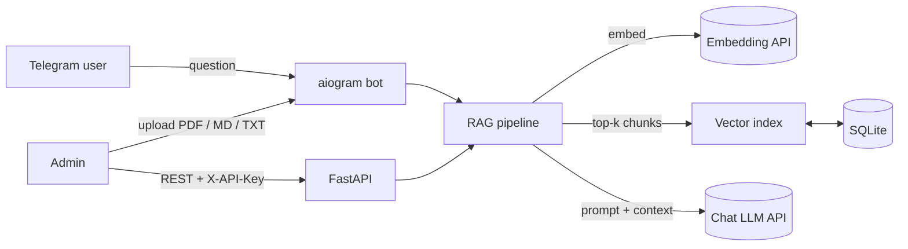

# DocuBot — AI Knowledge Base Assistant on Telegram

Turn your PDFs, manuals and FAQs into a Telegram bot that answers customer questions **with cited sources**.

Upload a document → ask a question in plain language → get an accurate answer that points to the exact file and page.

**🤖 Live demo: [@docubot_demo_bot](https://t.me/docubot_demo_bot)** — it's loaded with a sample FAQ for a fictional outdoor store. Try asking *"How long does shipping to Europe take?"*, *"Can I return sale items?"* or ask in your own language.

<!-- TODO: replace with demo GIF -->
<!--  -->

## Features

- **Retrieval-Augmented Generation (RAG)** — answers come only from your documents, with inline citations like `[1]` and a source list (`manual.pdf p.12`)
- **Telegram bot** — admins upload documents straight from the chat; users just ask questions
- **Multi-turn conversations** — follow-up questions keep context; `/reset` starts over
- **Any OpenAI-compatible LLM** — OpenAI, DeepSeek, Qwen, GLM, Kimi… switch providers by changing two env vars
- **Admin REST API** (FastAPI) — upload / list / delete documents, ask questions, review Q&A logs
- **Multilingual** — replies in the user's language
- **Production basics** — per-user rate limiting, API-key auth, structured logs with rotation, Docker deployment

## Architecture



**Ingest:** file → text extraction (per page) → overlapping chunks → embeddings → SQLite + in-memory vector index
**Answer:** question → embedding → cosine top-k search → LLM with numbered context → answer + sources → Q&A log

| Layer | Tech |
|---|---|
| Bot | aiogram 3 (async) |
| API | FastAPI, Pydantic v2 |
| Storage | SQLAlchemy 2 + aiosqlite |
| Retrieval | NumPy cosine similarity |
| LLM | OpenAI SDK against any compatible endpoint |
| Ops | Docker Compose, loguru |

## Quick start

```bash
git clone <repo-url> && cd docubot
cp .env.example .env          # fill in your keys
python3.12 -m venv .venv && source .venv/bin/activate
pip install -r requirements-dev.txt
uvicorn app.main:app --reload --port 8000
```

Then open your bot in Telegram, send `/start`, upload a PDF (as an admin) and ask away.

### Docker

```bash
cp .env.example .env
docker compose up -d --build
```

## Configuration

| Variable | Description | Default |
|---|---|---|
| `TELEGRAM_BOT_TOKEN` | Token from @BotFather; empty = API only | — |
| `ADMIN_IDS` | Telegram user IDs allowed to upload, e.g. `[123,456]` | `[]` |
| `ADMIN_API_TOKEN` | Secret for the REST API (`X-API-Key` header) | required |
| `CHAT_BASE_URL` / `CHAT_API_KEY` / `CHAT_MODEL` | Chat LLM endpoint | DeepSeek |
| `EMBED_BASE_URL` / `EMBED_API_KEY` / `EMBED_MODEL` | Embedding endpoint | SiliconFlow `BAAI/bge-m3` |
| `CHUNK_SIZE` / `CHUNK_OVERLAP` | Chunking in characters | `800` / `150` |
| `TOP_K` | Chunks retrieved per question | `5` |
| `RATE_LIMIT_PER_MINUTE` | Questions per user per minute | `10` |

Using OpenAI instead? Set `CHAT_BASE_URL=https://api.openai.com/v1`, `CHAT_MODEL=gpt-4o-mini`, and the same for embeddings.

## REST API

Interactive docs at `http://localhost:8000/docs`.

```bash
# Upload a document
curl -X POST localhost:8000/api/documents -H "X-API-Key: $TOKEN" -F "file=@docs/sample-store-faq.md"

# Ask a question
curl -X POST localhost:8000/api/ask -H "X-API-Key: $TOKEN" \
  -H "Content-Type: application/json" -d '{"question": "How long does shipping take?"}'

# List documents / recent Q&A logs / delete
curl localhost:8000/api/documents -H "X-API-Key: $TOKEN"
curl "localhost:8000/api/logs?limit=10" -H "X-API-Key: $TOKEN"
curl -X DELETE localhost:8000/api/documents/1 -H "X-API-Key: $TOKEN"
```

## Web chat with long-term memory

Open `http://localhost:8000/chat` for a browser chat UI built for long, ongoing conversations:

- **Saved threads** — create, switch, resume and delete chats; everything is stored in SQLite, so nothing is lost on refresh or restart
- **Long-term memory** — once a thread has more than `MEMORY_WINDOW` (20) unsummarized messages, everything except the latest `MEMORY_KEEP_RECENT` (8) is folded into a rolling summary by the LLM. Each request sends *summary + recent messages*, so context grows without hitting the model's window and old facts are condensed instead of dropped
- **Inspectable** — the *Memory* panel shows exactly what the assistant remembers
- **Demo-safe** — each browser gets an anonymous ID and only sees its own threads; per-IP rate limit and a per-thread message cap (`THREAD_MESSAGE_LIMIT`)

This is free-form chat (no document retrieval) using the same `CHAT_*` model settings as the bot.

| Endpoint (header `X-Visitor-Id: <uuid>`) | |
|---|---|
| `GET /chat/api/threads` | list your threads |
| `POST /chat/api/threads` | create a thread |
| `GET /chat/api/threads/{id}` | messages + current memory |
| `POST /chat/api/threads/{id}/messages` | send `{"content": "..."}`, get the reply |
| `DELETE /chat/api/threads/{id}` | delete a thread |

## Tests

```bash
pytest
```

Tests run fully offline — the LLM and embedding calls are replaced with deterministic fakes.

## Roadmap

- Embeddable chat widget for websites
- Postgres + pgvector for large document sets
- Hybrid search (BM25 + vectors) and re-ranking
- Admin dashboard

## Need something similar?

I build custom AI assistants, Telegram/Discord bots and automation for businesses. Feel free to reach out on Upwork.
